<picture>
  <source media="(prefers-color-scheme: dark)" srcset="assets/banner-dark.svg">
  
</picture>

I'm Ronak M Marlecha, co-founder of [Clairvyn](https://clairvyn.com). Architects describe a project, through a form or in their own words, and get back a floorplan they can download and keep working on. I build across the whole product, from how plans are generated to the app architects use and the cloud that runs it.

### What I work on

- **Floorplan generation**: turning an architect's brief into a clean, usable plan
- **The product**: the web app where architects write a brief, edit the plan and walk through it in 3D
- **CAD output**: drawings that open in the CAD tools architects already use
- **Cloud and delivery**: infrastructure as code, CI/CD, monitoring and releases
- **The business side**: pricing, billing and payments across India and abroad

### Tools I use

  

### Also

Passed Level I of the CFA Program.

My code is in private Clairvyn repositories, so the graph below shows activity, not public projects.

### Connect

[LinkedIn](https://www.linkedin.com/in/ronak-m-marlecha) · [clairvyn.com](https://clairvyn.com)
